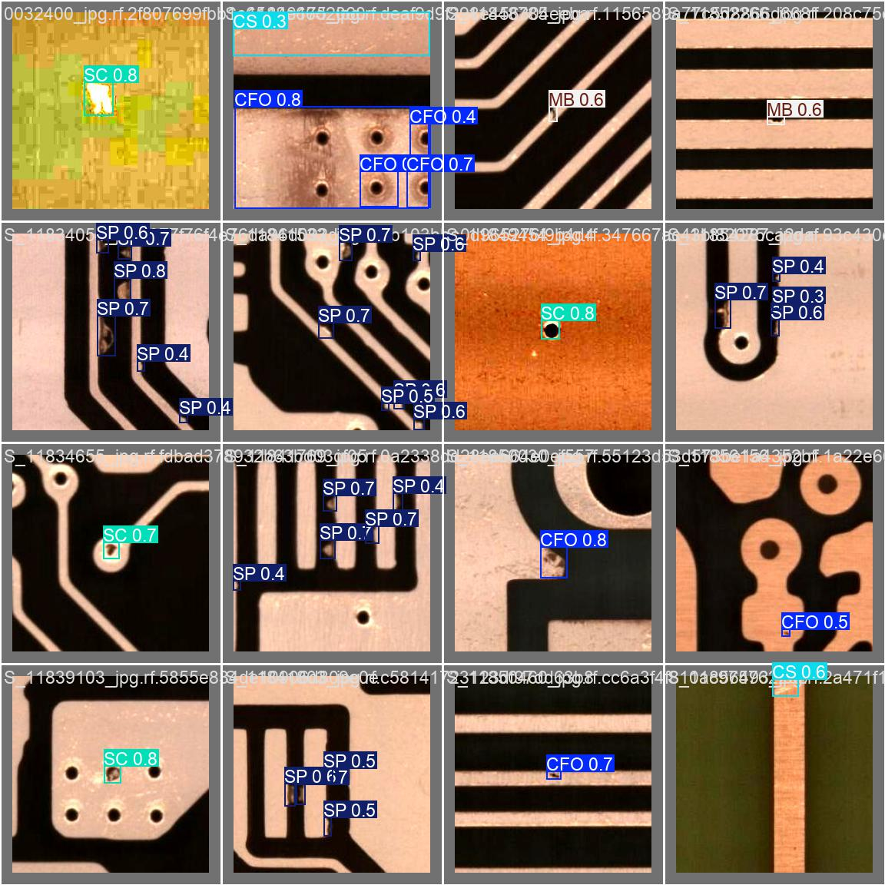

# PCB Defect Detection with YOLO

[Portfolio case study](https://scandial-portfolio.scandium.chatgpt.site/project-pcb.html) · Review the comparison, validation figures, and the full presentation in the browser.

An academic computer-vision case study for multi-class PCB defect detection using YOLO. It focuses on documenting the evaluated taxonomy and the recorded validation results, while excluding the source dataset and training environment.



## Recorded evaluation snapshot

| Label taxonomy | Recorded mAP@0.5 |
| --- | ---: |
| Nine classes | 0.826 |
| Five classes | 0.815 |

The comparison is useful because changing the label taxonomy changes the learning problem. The score difference is not a claim that one setup is universally better; it records the observed result for this coursework experiment.

## Per-class validation results

The values are transcribed from the [nine-class](assets/pcb-9class-pr.png) and [five-class](assets/pcb-5class-pr-final.png) precision-recall curves. Counts refer to the five-class label distribution and total 15,939 annotated instances.

| Class | Nine-class AP@0.5 | Five-class AP@0.5 | Five-class instances |
| --- | ---: | ---: | ---: |
| SH | 0.891 | — | — |
| SP | 0.826 | 0.846 | 4,836 |
| SC | 0.817 | 0.913 | 2,052 |
| OP | 0.855 | — | — |
| MB | 0.811 | 0.858 | 2,990 |
| HB | 0.983 | — | — |
| CS | 0.664 | 0.720 | 3,816 |
| CFO | 0.711 | 0.739 | 2,245 |
| BMFO | 0.874 | — | — |

## Recompute the published results

With Python 3.10 or later, run:

~~~bash
python tools/summarize_results.py
python -m unittest discover -s tests -v
~~~

The checked-in [metrics table](data/reported_metrics.csv) transcribes the final precision-recall legends and five-class count chart. The script recalculates mAP@0.5 for 9 and 5 classes (0.826 and 0.815), their difference (−0.011), and the 15,939 annotated instances. It also identifies the highest and lowest AP classes. The calculation starts from reported per-class AP values. Training and inference reproduction require the original split, annotations, configuration, and weights.

## Included evidence

- Training curves and precision-recall figures
- Confusion matrices and class-count summaries
- Example predictions
- Separate artifacts for five-class and nine-class experiments

## Scope and limitations

This repository is an academic portfolio record. The original dataset, model weights, training scripts, machine-specific paths, and raw experiment outputs are intentionally excluded because their public-release rights and reproducibility conditions have not been verified. See [docs/evidence.md](docs/evidence.md).

## Repository layout

```text
assets/       Public evaluation figures
docs/         Evidence, boundaries, and limitations
```

## License

Apache-2.0. See [LICENSE](LICENSE).
